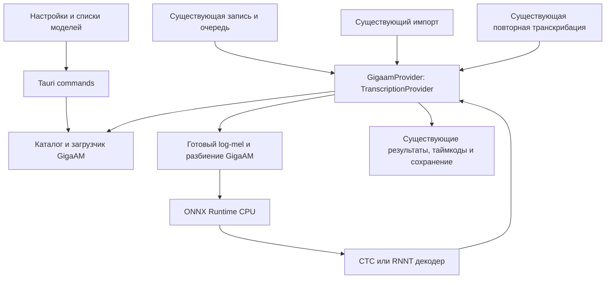

# Architecture Spine — GigaAM CPU

## Design Paradigm

Ports and Adapters в существующем Tauri-приложении: GigaAM — небольшой новый адаптер существующего `TranscriptionProvider`. UI управляет выбором и загрузками через Tauri; адаптер владеет готовым CTC/RNNT-движком на время операции. Запись, очереди, импорт, повторная обработка, отмена, настройки и сохранение остаются у существующих компонентов Meetily.

Коррекция от 2026-10-30 по запросу пользователя: максимально переиспользовать продукт. AD-1–AD-6 сохраняют ID и поведенческие гарантии; отдельный слой SessionFactory больше не является требованием. Доказательная база: [brownfield-audit.md](brownfield-audit.md).

## Invariants & Rules

### AD-1 — Встроенный CPU-движок [ADOPTED]

- **Binds:** CAP-1, CAP-2, поставка Windows.
- **Prevents:** отдельный сервер, Python-runtime, независимые движки для разных сценариев.
- **Rule:** GigaAM исполняется внутри приложения через существующий ONNX Runtime с явно выбранным CPUExecutionProvider. GPU-провайдеры не регистрировать. Один GigaamProvider реализует существующий TranscriptionProvider и оборачивает готовые CtcEngine/RnntEngine; общий конструктор используется тремя сценариями. Для live использовать существующий TranscriptionEngine::Provider. Переиспользовать TranscriptResult/TranscriptionError, настройки, audio decoder/resampler/VAD, worker, отмену и сохранение. Не вводить отдельный класс SessionFactory, общий session manager, scheduler или копии сценариев. Для нового механизма в задаче указать существующую точку расширения и конкретную недостающую гарантию. Существующие ветки Whisper/Parakeet и их ускорение сохранять.

### AD-2 — Идентичность и каталог моделей

- **Binds:** CAP-1, настройки, frontend/native интерфейсы, загрузчик.
- **Prevents:** разные имена и комплекты файлов для одной модели в UI и Rust.
- **Rule:** ключ провайдера `gigaam`; model ID — ровно `v3_ctc`, `v3_rnnt`, `v3_e2e_ctc`, `v3_e2e_rnnt`. Только FP32 [ADOPTED]. Rust-каталог — единственный источник состава пакета, размера и статуса; UI получает метаданные через команды, не дублирует URL и критерии готовности. Модели доступны в существующих настройках и списках обоих файловых сценариев только при наличии Windows x64 native-бэкенда; прочие платформы не предлагают неработающий GigaAM. Активный выбор хранится существующим механизмом provider/model. Старые сохранённые настройки и выбор по умолчанию не менять.

### AD-3 — Пакет модели публикуется целиком

- **Binds:** CAP-1, хранение, загрузки, инициализация.
- **Prevents:** запуск недокачанного или смешанного комплекта весов и словаря.
- **Rule:** хранение под Tauri app_data_dir, в отдельном пространстве `models/gigaam/<model-id>`. Переиспользовать уже реализованные catalog/DownloadManager и manifest: фиксированный revision, роли, размеры, SHA-256, metadata и лицензии; staging, проверка целого пакета и атомарная публикация до Available. Отмена/обрыв не публикуют частичный пакет и не повреждают прежний готовый пакет. Интернет нужен для скачивания, не для распознавания. Защиту активных файлов от удаления/замены реализовать небольшим per-model guard в этом же DownloadManager; адаптер/его native worker держит guard до последнего использования. Отдельный менеджер хранения и межпроцессный протокол не требуются.

### AD-4 — Выбор привязан к операции [ADOPTED]

- **Binds:** CAP-2, жизненный цикл модели, очередь записи.
- **Prevents:** смена модели посреди встречи или обработка последних фрагментов новым выбором.
- **Rule:** существующий обработчик при принятии операции фиксирует provider/model/language до длительного decode и очереди; явный выбор файлового диалога имеет приоритет. Передать неизменные значения конструктору GigaamProvider, без повторного чтения настроек внутри адаптера. Операция владеет Arc адаптера с собственным готовым CTC либо RNNT и локальным mutex; клоны используют тот же экземпляр, разные операции не меняют его модель. GigaAM использует исходный язык, игнорируя изменившийся hint live worker. Держать Arc до штатного сохранения/завершения очереди либо отмены с завершением задач; blocking worker также владеет Arc до конца native вызова. Вызовы сериализуются локально; RNNT-state уже изолирован в движке по сегментам. Переиспользовать существующий flush/join/save, добавив лишь удержание Arc до его конца. Выгрузка одной операции не инвалидирует другую. Новая инфраструктура очередей, session cache или общий lifecycle framework не нужны.

### AD-5 — Один аудио- и текстовый контракт

- **Binds:** CAP-2, препроцессинг, CTC/RNNT, сохранение.
- **Prevents:** разные результаты между сценариями из-за разных входов, декодеров или нормализации.
- **Rule:** вход GigaAM — mono f32 PCM 16 kHz после штатного декодирования/ресемплинга. Единственный владелец дополнительного разбиения GigaAM — внутренний segmentation adapter его provider; callers не реализуют отдельные GigaAM-splitters. Штатное общее разбиение файлов сохраняется, после него adapter проверяет каждый вход. Перед каждым вызовом ONNX обеспечивать строгий предел 400 000 samples (25 секунд). Существующий поиск границы тишины допускает отклонение ±3 секунды и сам по себе этот предел не гарантирует: GigaAM обязан проверять выходные части и доразбивать слишком длинные. Для всех трёх сценариев adapter объединяет внутренние части в один результат исходного входного сегмента, сохраняя его внешние временные метки; собственные внутренние части не сохраняются второй раз. Обработка завершения записи также проходит этот контроль. Log-mel и decoding сверять с эталоном именно выбранного ONNX-экспорта. CTC удаляет blank и повторы; RNNT использует собственные encoder/decoder/joint и ограничение эмиссий из фиксированной конфигурации. Не переносить TDT-декодер Parakeet. Словарь и правила detokenization закрепляются вместе с артефактами. Возвращать штатный TranscriptResult с confidence=None, is_partial=false; сохранять текущую схему временных меток сегментов. E2E-пунктуацию и нормализацию сохранять; дополнительный LLM не применять.

### AD-6 — Ошибки и совместимость

- **Binds:** CAP-1, CAP-2, маршрутизация, операции.
- **Prevents:** незаметное распознавание Whisper вместо выбранного GigaAM и повреждение существующего результата.
- **Rule:** явный `gigaam` обрабатывать до старых default-to-Whisper веток, включая файловые сценарии и batch cleanup. Неизвестная модель GigaAM, повреждённый пакет или ошибка ONNX дают штатную явную ошибку; автоматическую подмену движка не выполнять. Русский/авто совместимы с моделями; иной явно выбранный язык отклонять до запуска, без обещания multilingual. При отмене и ошибке использовать существующие правила операций для временных данных и сохранённого текста; существующий текст не заменять пустым результатом из-за технической ошибки. Логи содержат ID модели и CPU-бэкенд, без аудио и текста встреч. Это правило распространяется на GigaAM-ветки общих worker/import/retranscription wrappers: существующие text-bearing сообщения должны обходиться или редактироваться для GigaAM, что проверяется синтетическим маркером. confidence=None сохраняет смысл отсутствия оценки во всех затронутых адаптерах; legacy числовой fallback не выдавать за измеренную уверенность GigaAM. Точное отображение отсутствующей оценки согласовать с текущим форматом хранения при подготовке задач.

## Structural Seed

Rust-модуль GigaAM уже содержит каталог, загрузчик, препроцессинг и декодеры. Остаётся небольшой адаптер существующего trait с простым конструктором; точное размещение закреплено в Story 1.5. В существующих engine/readiness/worker/import/retranscription добавить GigaAM-ветки. Frontend дополняет текущие TranscriptSettings, useTranscriptionModels и readiness; готовый GigaAMModelManager получает выбор модели и использует существующее сохранение provider/model. Не создавать параллельные обработчики операций, сервер, БД или модель хранения встреч.

| Компонент | Проверенная исходная версия |
| --- | --- |
| Rust ort | 2.0.0-rc.10, текущий Cargo.lock |
| Windows ONNX Runtime | 1.22.0, текущая поставка приложения |

Эти версии уже подтверждены компонентными Windows CPU-проверками четырёх моделей и Rust-движков. Сохранять их; текущая задача не требует обновления зависимостей.

## Capability → Architecture Map

| Capability | Области | Правила |
| --- | --- | --- |
| CAP-1 | Настройки, списки, каталог, загрузки | AD-1, AD-2, AD-3, AD-6 |
| CAP-2 | Запись, импорт, повторная обработка, provider, сохранение | AD-1, AD-4, AD-5, AD-6 |

## Verification Contract

- На Windows проверить все 12 сочетаний: четыре модели × три сценария, только синтетическая русская речь; результат осмысленный и сохранён, загруженные модели работают offline.
- Проверить отмену/обрыв загрузки, повреждённый файл, повторное открытие приложения и сохранение выбранной модели, явные ошибки без перехода на Whisper.
- Проверить строгую длину каждой части ≤400 000 samples и смену языка после snapshot. Проверить изменение настройки между сегментами и при завершении записи: текущая операция сохраняет исходный model ID, следующая использует новый. Проверить конкурирующие операции и освобождение одной из них.
- Препроцессинг/декодеры проверить по фиксированным входам против эталона соответствующего экспорта, включая короткий вход, тишину, blank/repeated tokens и границы сегментов. Отдельно проверить E2E-текст без потери пунктуации.
- Smoke-проверки Whisper/Parakeet во всех затронутых путях. Сборка или браузерный UI не заменяют native Windows acceptance. Бенчмарки и пороги скорости исключены решением пользователя.
- Использовать существующие fixtures/проверки движков и данные 1.1–1.4. При неизменном вычислительном коде не повторять подготовку пакетов/численные проверки в каждой истории; проверять новый адаптер и затронутую интеграцию. Повторный model smoke нужен при изменении вычислений, runtime, пакета или обнаруженном регрессе. Итоговая матрица 4×3 остаётся обязательной.

## Deferred

- Отображение отсутствующей confidence в live event/UI уточнить в технической задаче интеграции до изменения типов; переиспользовать текущую схему хранения, не подставлять измеренную оценку. Файловые transcript segments уже не требуют поля confidence; отдельная миграция БД не нужна.
- Точные места capture/удержания Arc при live start/stop и файловой отмене уточнить в code map соответствующей истории; использовать текущие обработчики, не моделировать их отдельной очередью в тестах адаптера.
- Исправление общей изоляции Whisper/Parakeet — отдельная задача: текущий общий mutable engine не доказывает фиксацию модели операции. Для GigaAM гарантия AD-4 обязательна.
- Производительность CPU принята достаточной без измерений. Поддержка GPU, INT8, других ОС и новых функций диаризации не входит в эту архитектуру.

## Evidence

- Требования: SPEC.md; подтверждённые решения и основания: .memlog.md этого пакета.
- Контракт пакетов/ABI/численные допуски уже закреплены: model-contract.md и tools/gigaam-model-contract/manifest.json. Команды gigaam_get_available_models/gigaam_download_model/gigaam_cancel_download и событие gigaam-model-download-progress уже реализованы; их не проектировать повторно.
- Аудит переиспользования и текущей незавершённости: brownfield-audit.md. Техническая подготовка 1.1–1.4 имеет собственные отчёты; текущие GigaAM-маршруты приложения и native acceptance ещё не готовы.
- Проверены текущие исходники: transcription/provider и worker, audio/import и retranscription, общий frontend hook списка моделей, загрузчик Windows ONNX Runtime. Архитектура описывает целевую интеграцию, не утверждает её реализацию.
- Каталог FP32-файлов: https://huggingface.co/istupakov/gigaam-v3-onnx/tree/main
- Код владельца экспортов: https://github.com/istupakov/onnx-asr/blob/main/src/onnx_asr/models/gigaam.py
- Официальная реализация GigaAM: https://github.com/salute-developers/GigaAM

## Дополнение CC-2: повторный аудит 1.1–1.4

[Покомпонентный пересмотр](reuse-audit-1-1-to-1-4.md) заменяет прежнее безусловное сохранение уже реализованных компонентов. Перед адаптером в 1.5 revision 3 консолидировать две общие функции: streaming-to-writer из существующего Parakeet и одинаковую очистку текста Parakeet/GigaAM. Package validation/publication и log-mel/CTC/RNNT GigaAM сохраняются по конкретным ABI/state-различиям, не по факту ранее выполненной работы. Parakeet содержит обычную RNNT-ветку; прямое использование её через текущий combined decoder_joint не соответствует выбранному GigaAM ABI/cache. Допускается ограниченное изменение Parakeet для двух общих функций с регрессионной проверкой; новый общий lifecycle/decoder framework не требуется. Все AD и пользовательские гарантии сохранены; после изменения cleanup нужны адресные model smoke, а прежние результаты не объявляются проверкой нового кода.
